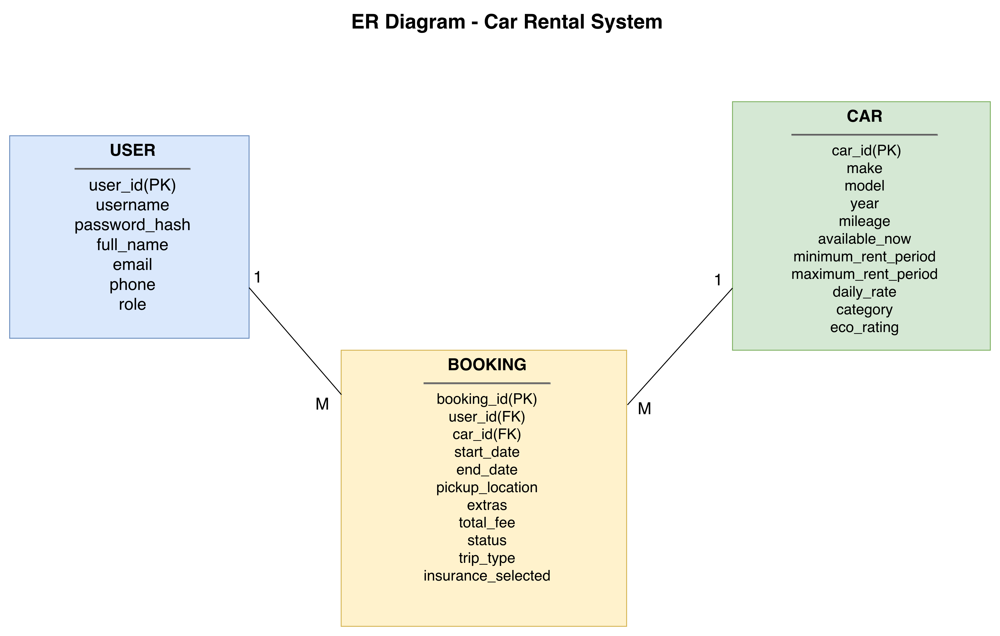
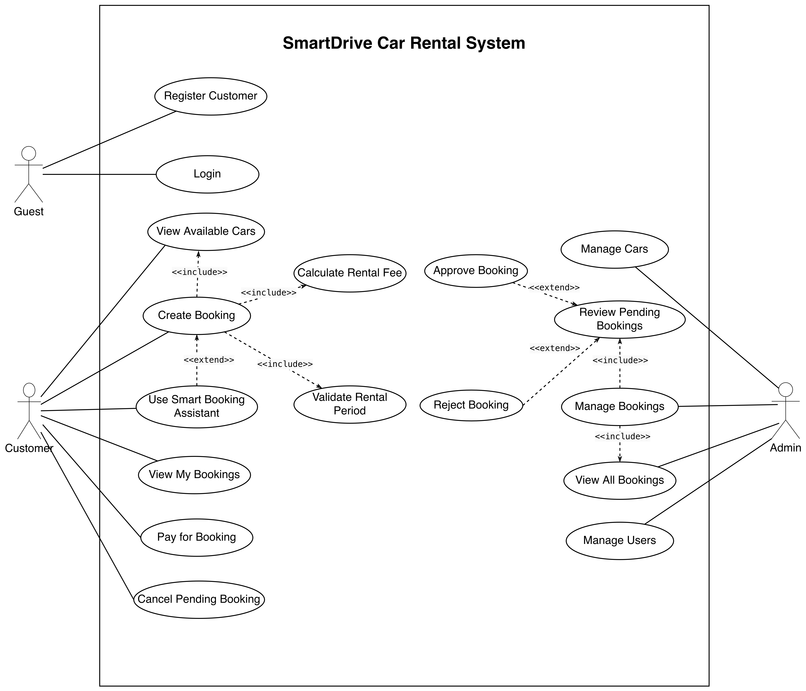
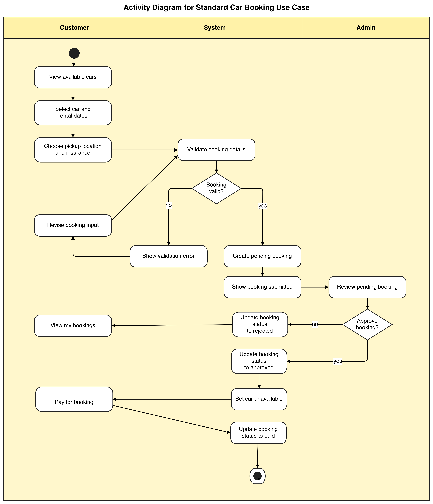
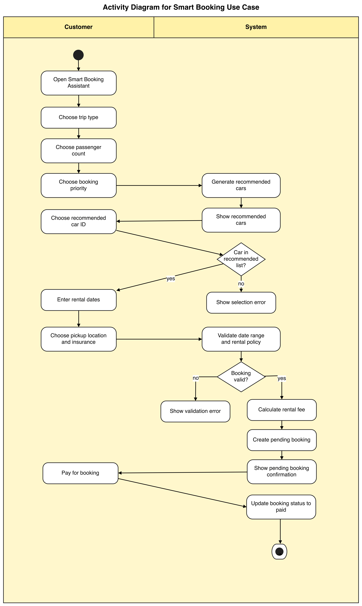

# SmartDrive Car Rental System

`SmartDrive Car Rental System` is a command-line car rental project developed for `MSE800 Professional Software Development - Assessment 1`.  

## Key Feature

This project includes two key features that are both important to the final system.

The first is the `Standard Booking` workflow, developed for `Task 1: Design and Architecture (LO1)`. It covers the main rental process, including viewing available cars, creating bookings, validation, admin review, and payment.

The second is the `Smart Booking Assistant`, developed for `Task 2: Innovative Solutions (LO2)`. It improves the normal booking experience by asking for simple customer preferences and recommending suitable cars before the booking is created.

## Requirements

- Python `3.8+`
- macOS, Linux, or Windows
- Terminal or command prompt

## Run the System

Open a terminal in the `Assessment1` folder and run:

```bash
python3 app.py
```

When the program starts, it will:

- create the SQLite database if needed
- create the required tables
- create the default admin account
- add a starter list of rental cars so the system can be used immediately

## Default Admin Account

- Username: `admin`
- Password: `admin123`

## System Overview

The system supports three user roles:

- `Guest`: register, log in, or exit
- `Customer`: view available cars, create bookings, use the Smart Booking Assistant, view personal bookings, pay approved bookings, and cancel pending bookings
- `Admin`: manage cars, manage bookings, review pending bookings, view all bookings, approve or reject bookings, and manage users

The main workflow is:

1. A guest registers or logs in
2. A customer selects a car and creates a booking
3. The system validates the rental period and calculates the rental fee
4. The booking is saved with pending status
5. An admin reviews the booking
6. The admin approves or rejects it
7. If approved, the car becomes unavailable
8. The customer pays for the approved booking
9. The booking status is updated to paid

## Diagrams

### ER Diagram



This diagram presents the core data structure of the rental system through the entities `User`, `Car`, and `Booking`.
It shows that one user can create multiple bookings, while each booking is linked to one selected car.
The diagram also makes the main data relationships clear, including the identifiers used to connect bookings with users and cars.

### Use Case Diagram



This diagram shows how the three actors, `Guest`, `Customer`, and `Admin`, interact with the main functions of the system.
It separates the system boundary from the external actors and makes each role's responsibilities easy to see.
The relationships between use cases also show which functions are part of the normal booking flow and which ones extend or support it.

### Standard Booking Activity Diagram



This diagram describes the standard booking workflow from customer input to admin review and final payment.
It shows the sequence of activities, decision points, and status changes across the customer, system, and admin roles.
It represents the baseline booking process developed for `Task 1`, including validation, admin review, and payment completion.

### Smart Booking Activity Diagram



This diagram focuses on the Smart Booking Assistant as a separate booking path with recommendation logic.
It shows how customer preferences are collected and how the system produces recommended cars before booking creation.
It supports the innovative feature discussed in `Task 2: Innovative Solutions (LO2)` by modelling the enhanced user experience.

## Main Functions

The system includes several core functions that support both customer use and administration.

- `Registration and login`: guests can create a customer account and log in to access the system
- `Customer booking functions`: customers can view available cars, create bookings, view their own bookings, pay approved bookings, and cancel pending bookings
- `Admin management functions`: admins can manage cars, manage users, view all bookings, and review pending bookings
- `Rental fee calculation`: the system automatically calculates booking cost based on daily rate, rental duration, and optional insurance
- `Smart Booking Assistant`: the system recommends suitable cars based on simple customer preferences, which makes the booking process more practical and more user-friendly

## Project Structure

- [app.py](/Users/fanfan/Documents/GitHub/MSE800-Assessment/Assessment1/app.py:1): application entry point
- [cli.py](/Users/fanfan/Documents/GitHub/MSE800-Assessment/Assessment1/cli.py:1): menu flow and user interaction
- [services.py](/Users/fanfan/Documents/GitHub/MSE800-Assessment/Assessment1/services.py:1): business logic
- [repositories.py](/Users/fanfan/Documents/GitHub/MSE800-Assessment/Assessment1/repositories.py:1): database operations
- [models.py](/Users/fanfan/Documents/GitHub/MSE800-Assessment/Assessment1/models.py:1): data models
- [bootstrap.py](/Users/fanfan/Documents/GitHub/MSE800-Assessment/Assessment1/bootstrap.py:1): schema creation and seed data
- [database.py](/Users/fanfan/Documents/GitHub/MSE800-Assessment/Assessment1/database.py:1): SQLite wrapper
- [diagrams](/Users/fanfan/Documents/GitHub/MSE800-Assessment/Assessment1/diagrams:1): editable and exported system diagrams

## Test

The system was mainly checked through manual CLI testing.
One of the most important results is the `Smart Booking Assistant`, because it shows that the system can collect user preferences, recommend suitable cars, create a pending booking, and then continue through the standard review and payment workflow.

Example test result:

```text
Customer Menu
1. View available cars
2. Create booking
3. Smart booking
4. View my bookings
5. Pay for booking
6. Cancel booking
7. Logout
Choose an option: 3

Smart Booking Assistant
Answer a few quick questions and the system will suggest suitable cars.

1. What type of trip is this?
1. City travel
2. Family outing
3. Business travel
4. Long-distance trip
Choose the best match: 1

2. How many people are travelling?
1. 1-2 people
2. 3-5 people
Choose the best match: 1

3. What matters most to you?
1. Lower price
2. Newer car
3. Lower mileage
4. Longer rental flexibility
Choose one priority: 1

Recommended cars for your trip
[1] 2021 Suzuki Swift | mileage 36000 | rate $58.00/day | rent 1-5 days | available yes
[2] 2023 Toyota Corolla Hybrid | mileage 18000 | rate $76.00/day | rent 1-12 days | available yes
[3] 2024 Mazda 3 | mileage 12000 | rate $88.00/day | rent 1-10 days | available yes
Choose one of the recommended Car IDs: 1
Start date (YYYY-MM-DD): 2026-05-05
End date (YYYY-MM-DD): 2026-05-09
Pickup locations
1. Auckland CBD
2. Auckland Airport
3. North Shore
Choose pickup location: 1
Add insurance? (y/n): n
Booking #3 created. Days: 5, base $290.00, insurance $0.00, total $290.00.
```

The full manual testing record, including the later admin approval and customer payment steps, has been organised in [manual_test_cases.md](/Users/fanfan/Documents/GitHub/MSE800-Assessment/Assessment1/docs/manual_test_cases.md:1) and will be expanded later in the user document.

## Note

This `README` is a short project summary.  
The detailed explanation of the system, diagrams, and user guidance will be provided in the separate user document.
