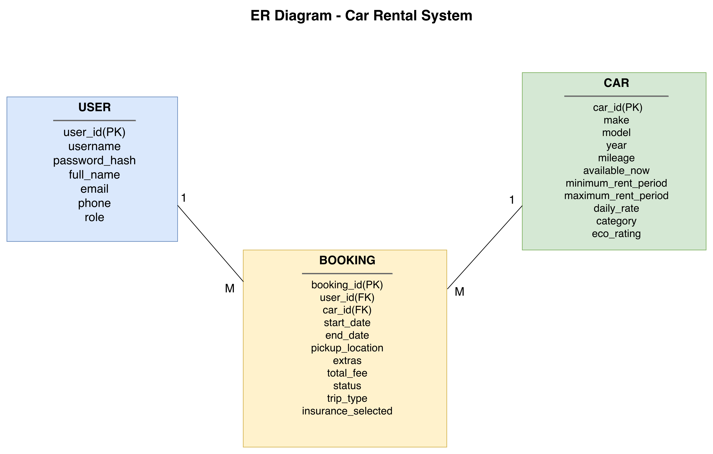
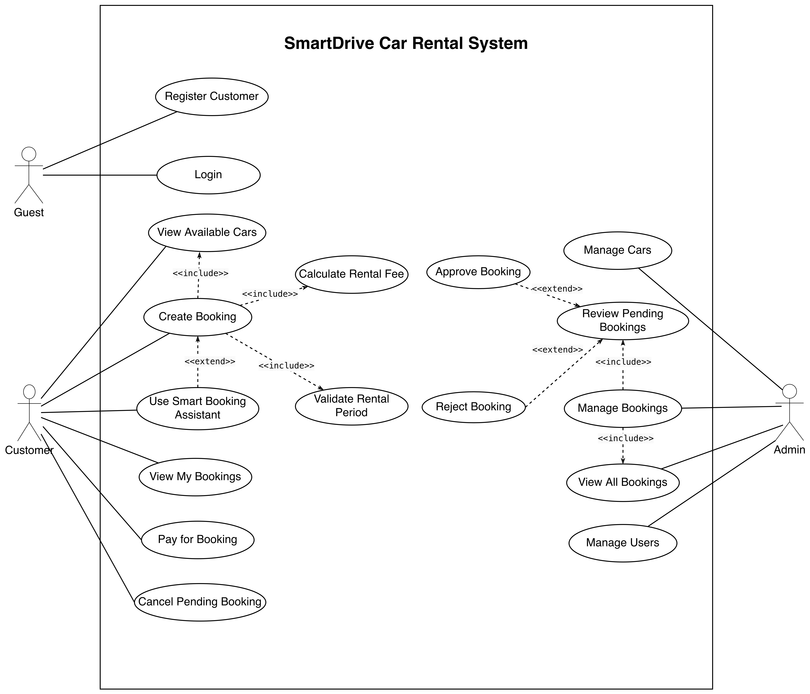
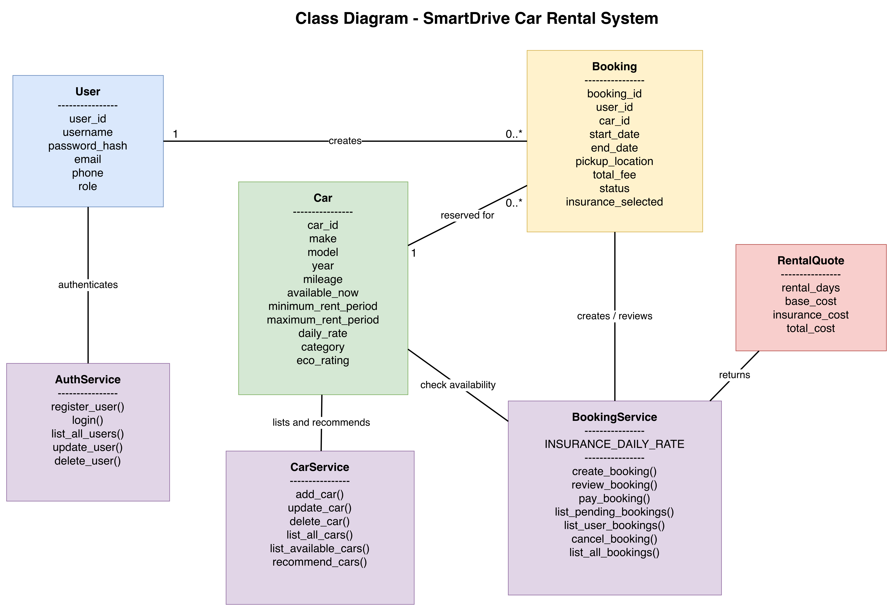
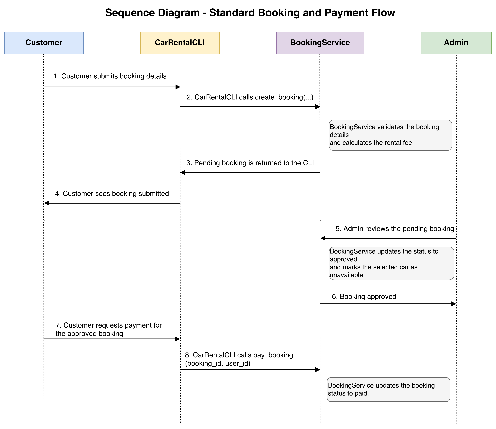
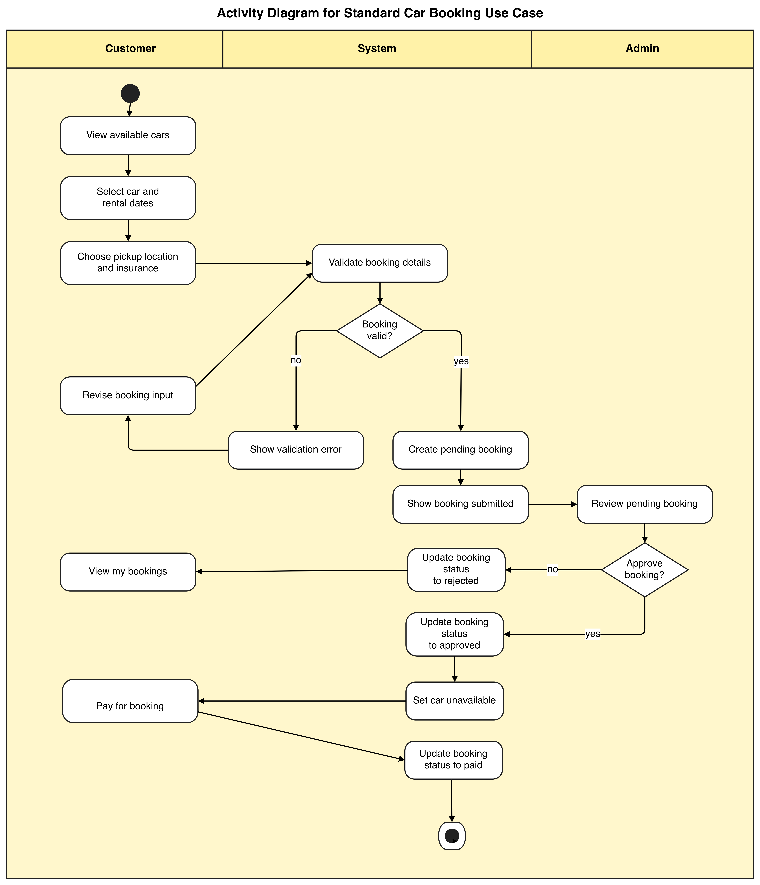
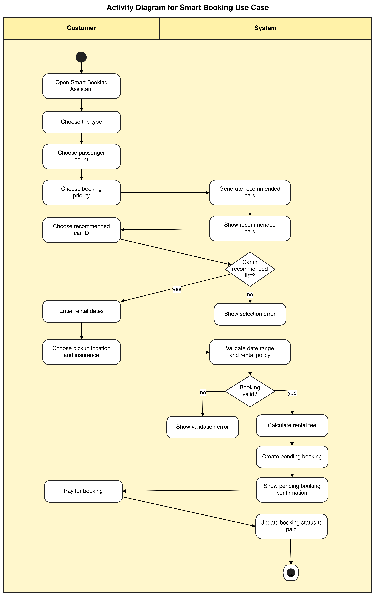

# SmartDrive Car Rental System

`SmartDrive Car Rental System` is a command-line car rental project developed for `MSE800 Professional Software Development - Assessment 1`.  

## Developer Information

- Developer: `Fan Fan`
- Student ID: `270958057`
- Student Email: `270958057@yoobeestudent.ac.nz`
- Course: `MSE800 Professional Software Development`
- Project: `Assessment 1 - SmartDrive Car Rental System`

## Key Feature

This project covers two major features that together form the complete SmartDrive car rental system.

The first is the `Standard Booking` workflow, developed for `Task 1: Design and Architecture (LO1)`. This feature supports the core rental process, including customer registration and login, viewing available cars, creating a booking, validating rental details, selecting pickup location and insurance, admin review of pending bookings, and customer payment for approved bookings. It represents the main operational flow of the system and provides the essential structure needed for everyday car rental management.

The second is the `Smart Booking Assistant`, developed for `Task 2: Innovative Solutions (LO2)`. This feature improves the standard booking process by asking the customer about trip type, passenger count, and booking priority, then recommending suitable cars before the booking is created. It gives the system a more guided and user-friendly experience than a traditional booking workflow, while also highlighting the project's innovative value through a more personalised booking path.

## Requirements

- Python `3.8.20`
- Tested on macOS
- Terminal or command prompt
- No external packages are required to run the core application

## Run the System

Follow these steps to run the system:

1. Open a terminal.

2. Start the application:

```bash
python3 app.py
```

When the program starts, it will automatically:

- create the SQLite database if needed
- create the required tables
- create the default admin account
- add a starter list of rental cars so the system can be used immediately

## Default Admin Account

- Username: `admin`
- Password: `admin123`

## System Overview

The system supports three user roles:

- `Guest`: register, log in, or exit
- `Customer`: view available cars, create bookings, use the Smart Booking Assistant, view personal bookings, pay approved bookings, and cancel pending bookings
- `Admin`: manage cars, manage bookings, review pending bookings, view all bookings, approve or reject bookings, and manage users

The main workflow is:

1. A guest registers or logs in
2. A customer selects a car and creates a booking
3. The system validates the rental period and calculates the rental fee
4. The booking is saved with pending status
5. An admin reviews the booking
6. The admin approves or rejects it
7. If approved, the car becomes unavailable
8. The customer pays for the approved booking
9. The booking status is updated to paid

## Diagrams

### ER Diagram



This diagram presents the core data structure of the rental system through the entities `User`, `Car`, and `Booking`.
It shows that one user can create multiple bookings, while each booking is linked to one selected car.
The diagram also makes the main data relationships clear, including the identifiers used to connect bookings with users and cars.

### Use Case Diagram



This diagram shows how the three actors, `Guest`, `Customer`, and `Admin`, interact with the main functions of the system.
It separates the system boundary from the external actors and makes each role's responsibilities easy to see.
The relationships between use cases also show which functions are part of the normal booking flow and which ones extend or support it.

### Class Diagram



This diagram presents the main classes involved in the rental workflow, including `User`, `Car`, `Booking`, `RentalQuote`, and the main service classes.
It shows the key attributes, major methods, and the main associations used in authentication, car recommendation, booking creation, review, and payment.

### Sequence Diagram



[Sequence Diagram Source](diagrams/sequence_diagram.drawio)

This sequence diagram focuses on the main interaction flow in the standard booking process.
It shows how the customer starts a booking, how the booking is created as pending, how the admin reviews it, and how the customer later completes payment for an approved booking.
It complements the other UML diagrams by showing the order of messages between the main participants instead of only their structure.

### Standard Booking Activity Diagram



This diagram describes the standard booking workflow from customer input to admin review and final payment.
It shows the sequence of activities, decision points, and status changes across the customer, system, and admin roles.
It represents the baseline booking process developed for `Task 1: Design and Architecture (LO1)`, including validation, admin review, and payment completion.

### Smart Booking Activity Diagram



This diagram focuses on the Smart Booking Assistant as a separate booking path with recommendation logic.
It shows how customer preferences are collected and how the system produces recommended cars before booking creation.
It supports the innovative feature discussed in `Task 2: Innovative Solutions (LO2)` by modelling the enhanced user experience.

## Main Functions

The system includes several core functions that support both customer use and administration.

- `Registration and login`: guests can create a customer account and log in to access the system
- `Customer booking functions`: customers can view available cars, create bookings, view their own bookings, pay approved bookings, and cancel pending bookings
- `Admin management functions`: admins can manage cars, manage users, view all bookings, and review pending bookings
- `Rental fee calculation`: the system automatically calculates booking cost based on daily rate, rental duration, and optional insurance
- `Smart Booking Assistant`: the system recommends suitable cars based on simple customer preferences, which makes the booking process more practical and more user-friendly

## Project Structure

```text
Project root/
├── README.md
├── requirements.txt
├── app.py
├── cli.py
├── models.py
├── services.py
├── repositories.py
├── database.py
├── bootstrap.py
├── decorators.py
├── data/
│   └── car_rental.db
├── diagrams/
│   ├── *.drawio
│   └── *.png
├── docs/
│   └── manual_test_cases.md
```

- `README.md`: project overview, setup guide, and submission summary
- `requirements.txt`: Python package dependency note
- `app.py`: application entry point
- `cli.py`: menu flow and user interaction
- `services.py`: business logic
- `repositories.py`: database operations
- `models.py`: data models
- `bootstrap.py`: database setup and starter data
- `database.py`: SQLite wrapper
- `decorators.py`: decorator utilities
- `diagrams/`: editable and exported system diagrams
- `docs/manual_test_cases.md`: detailed manual testing record

## Known Issues

- The payment step is simplified. It updates booking status to `paid`, but it does not connect to a real payment gateway or produce receipts.
- A car becomes unavailable as soon as an admin approves the booking. In a larger production system, this rule might be refined further.
- The system is designed as a terminal application, so it does not include a graphical web or mobile interface.

## Licensing Terms

This project was prepared for academic assessment use in `MSE800 Professional Software Development`.
It is not released as a commercial product.
The code and documentation should be treated as coursework material unless the author states otherwise.

## Test

The system was mainly checked through manual CLI testing.
One of the most important results is the `Smart Booking Assistant`, which shows that the system can collect user preferences, recommend suitable cars, create a pending booking, and then continue through the standard review and payment workflow.

Example test result:

```text
Customer Menu
1. View available cars
2. Create booking
3. Smart booking
4. View my bookings
5. Pay for booking
6. Cancel booking
7. Logout
Choose an option: 3

Smart Booking Assistant
Answer a few quick questions and the system will suggest suitable cars.

1. What type of trip is this?
1. City travel
2. Family outing
3. Business travel
4. Long-distance trip
Choose the best match: 2

2. How many people are travelling?
1. 1-2 people
2. 3-5 people
Choose the best match: 2

3. What matters most to you?
1. Lower price
2. Newer car
3. Lower mileage
4. Longer rental flexibility
Choose one priority: 3

Recommended cars for your trip
[5] 2024 Hyundai Tucson | mileage 11000 | rate $112.00/day | rent 2-21 days | available yes
[8] 2023 Kia Carnival | mileage 15000 | rate $138.00/day | rent 2-14 days | available yes
[10] 2025 Mercedes-Benz C200 | mileage 5000 | rate $165.00/day | rent 1-14 days | available yes
Choose one of the recommended Car IDs: 8
Start date (YYYY-MM-DD): 2025-05-01
End date (YYYY-MM-DD): 2025-05-10
Pickup locations
1. Auckland CBD
2. Auckland Airport
3. North Shore
Choose pickup location: 2
Add insurance? (y/n): y
Booking #5 created. Days: 10, base $1380.00, insurance $200.00, total $1580.00.
```

The full manual testing record, including the later admin approval and customer payment steps, is provided in `docs/manual_test_cases.md`.

## Note

This `README` is a short project summary.  
The detailed explanation of the system, diagrams, and user guidance is provided in the separate user document.
